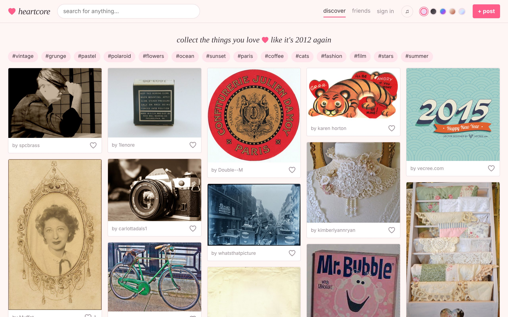
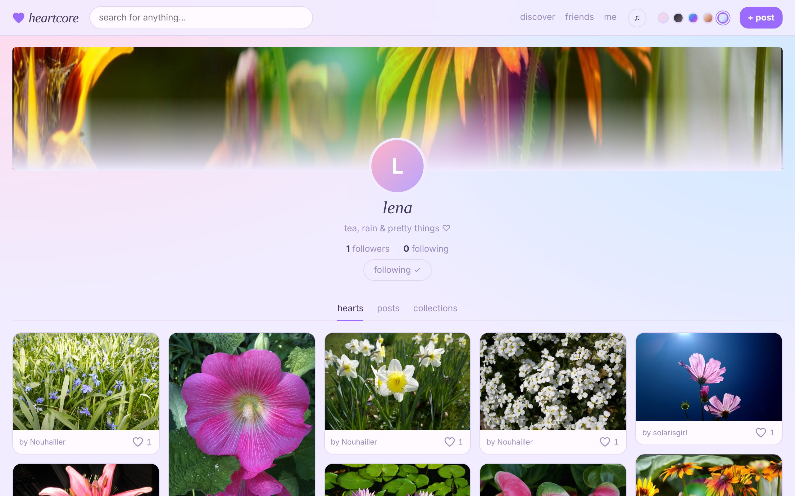
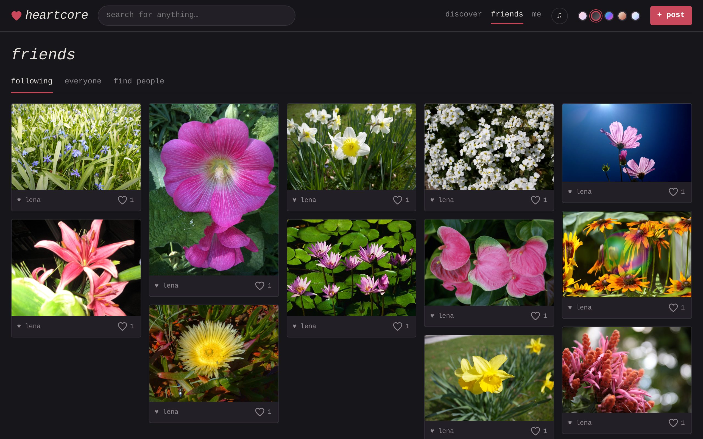
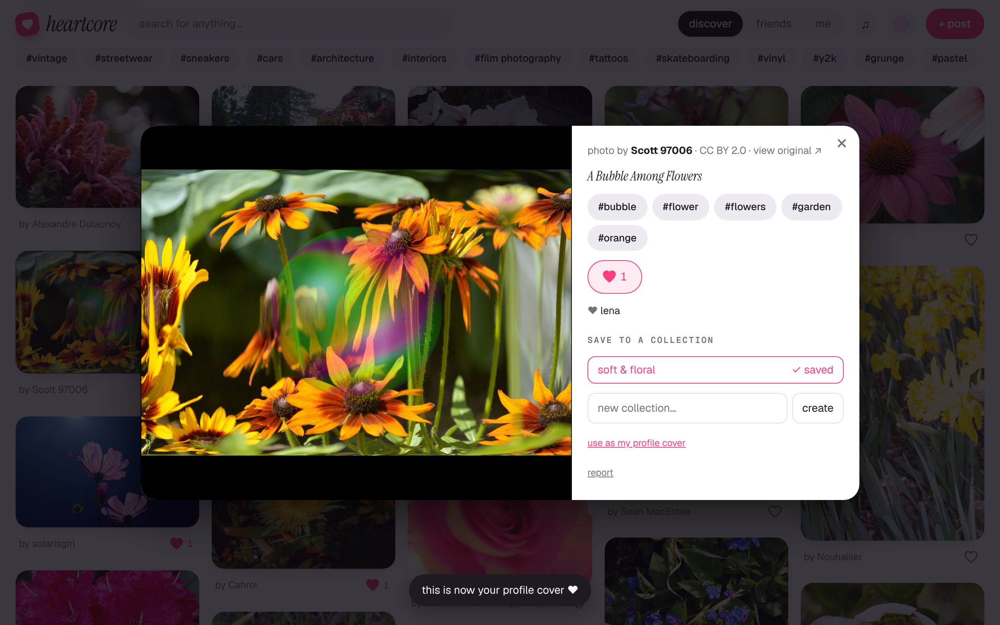
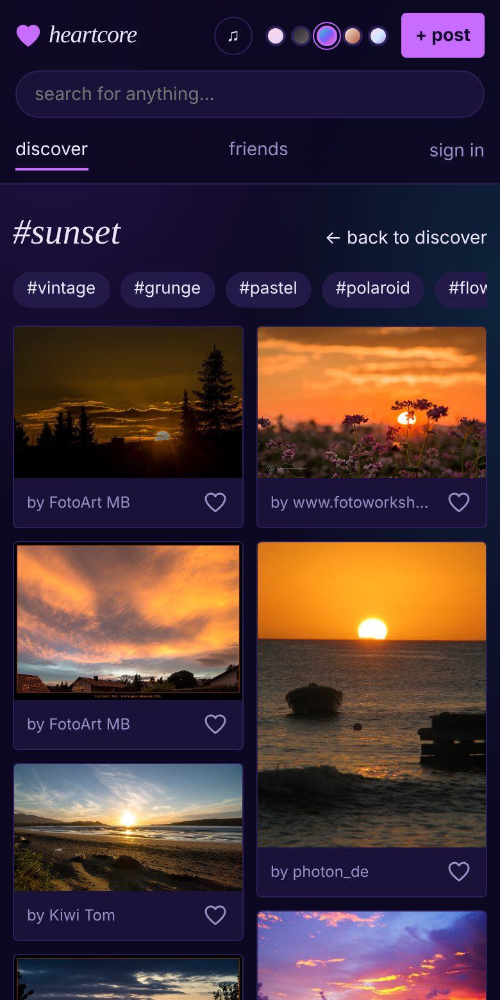

# heartcore ♥

[](https://github.com/SaraL6/weheartit-clone/actions/workflows/ci.yml)
[](LICENSE)

**An ad-free place to heart and collect images, built for everyone who misses the Tumblr era.**

**[Try the live demo →](https://heartcore-tau.vercel.app/)**



## Why I built it

In high school I had thousands of images saved on an image-bookmarking site I
loved. It shut down and all of it went with it. The big alternatives are now
full of ads, AI-generated images and feeds decided by an algorithm. heartcore is
the opposite: a quiet, pretty place to collect things you love, follow friends,
and take everything with you whenever you want.

## What it does

- **Discover** — endless scroll of real photos with search: new ones from
  Unsplash mixed with old ones from Flickr (or just one, at the flick of a
  switch), or Openverse when neither is set up, across topics for every kind of curator: streetwear, sneakers,
  cars, architecture, interiors, film photography, tattoos, vinyl and more
- **Hearts and collections** — heart anything, or hit **save** on any image
  to drop it straight into a collection, Pinterest-style
- **Post** — upload a jpg/png/gif, share an image link, or post some words
  as a quote card in one of four styles
- **Friends** — follow people and see what they heart, in the order it happened
- **Your canvas** — pick any image as your profile cover; visitors see your
  page in the vibe you chose: pastel, darkroom, y2k chrome, soft grunge, galaxy,
  vintage or daydream
- **Make it yours** — a mood, your own profile colour, a top 8 of your
  favourite people, a guestbook for friends to sign, and a little visit counter
- **Notes** — see who else hearted an image
- **Music** — paste a Spotify link to listen while you browse, connect your
  Spotify for full songs, and put a playlist on your profile for visitors to play
- **Take it with you** — "download everything" saves your hearts, posts and
  collections as one web page, so they can never vanish
- **Human-made only** — no AI-generated images; no ads; no tracking; heart
  counts can be hidden
- **Safety built in** — report button on every image, a moderation queue,
  takedowns, rules and privacy pages, account deletion

| | |
| --- | --- |
|  |  |
| A profile in its owner's theme and colour, with mood, visit counter and top 8 | The friends feed |
|  |  |
| Saving to a collection, with photographer credit | On a phone |

## How it's built

**React 18 · TypeScript · Vite · Supabase (Postgres, Auth, Storage) · Vitest · GitHub Actions**

There is no custom server: the browser talks straight to Postgres through
Supabase, so the database itself has to enforce who can do what.

- **Security lives in the database.** Every table has row-level security: you
  can read what's public and change only what's yours. Heart counts are kept
  by a trigger and can't be written by clients. The few privileged actions
  (saving a library image once, resolving a report, deleting an account) are
  narrow `security definer` functions. See [`supabase/schema.sql`](supabase/schema.sql).
- **Those rules are tested.** [`supabase/tests/rules.test.sql`](supabase/tests/rules.test.sql)
  runs 60 checks against a real Postgres in CI — for example that you can't
  heart as someone else, forge a count, read reports, or make yourself an admin.
- **Instant-feeling UI.** Hearts and follows update immediately and roll back
  if the server refuses.
- **One image model, several sources.** Library photos and member uploads
  share one shape, and a library photo is only written to the database the
  first time someone hearts or saves it. Image sources are swappable modules.
- **Untrusted input is treated as untrusted.** Spotify links are reduced to a
  validated `type/id` before a player is ever created, the exported page
  escapes every caption, and uploads are resized in the browser.
- **Moderation is part of the design**, not an afterthought: takedowns also
  hide library photos, clear profile covers and close duplicate reports.

| File | What it does |
| --- | --- |
| `src/store.ts` | Signed-in state: who you are, what you've hearted, who you follow. |
| `src/api.ts` | Every other database read and write, and the export. |
| `src/images.ts`, `src/unsplash.ts`, `src/flickr.ts`, `src/openverse.ts` | Image search: mixes Unsplash and Flickr when both keys are set, otherwise whichever is set, otherwise Openverse. |
| `src/music.tsx`, `src/spotify.ts` | The music player, and Spotify sign-in (PKCE) with in-page full-song playback. |
| `src/profile.tsx` | Profile extras: mood, colour, top 8, guestbook, visit counter. |
| `src/App.tsx`, `src/components.tsx` | Pages and building blocks. |
| `src/legal.tsx` | Rules, terms, privacy and copyright pages. |
| `supabase/schema.sql` | Tables, access rules, triggers, storage, reports and moderation. |
| `supabase/tests/` | Access-rule tests and the stand-ins needed to run them on plain Postgres. |

## Run it locally

```bash
npm install
npm run dev      # the site, browse-only until Supabase is connected
npm test         # unit tests
npm run build    # type-check and production build
```

Database tests, against any local Postgres:

```bash
createdb heartcore_test
psql -d heartcore_test -v ON_ERROR_STOP=1 -q \
  -f supabase/tests/stubs.sql -f supabase/schema.sql -f supabase/tests/rules.test.sql
```

## Set up accounts (Supabase, about 5 minutes)

1. Create a free project at [supabase.com](https://supabase.com).
2. In the dashboard open **SQL Editor**, paste the whole of
   [`supabase/schema.sql`](supabase/schema.sql) and press **Run**. This creates
   the tables, the access rules and the storage bucket for uploads.
3. Open **Project Settings → API** and copy the **Project URL** and the
   **anon public** key.
4. Copy `.env.example` to `.env.local`, paste the two values in, and restart
   `npm run dev`. Optionally add `VITE_UNSPLASH_ACCESS_KEY` to use Unsplash.

Good to know:

- New Supabase projects ask people to confirm their email before signing in.
  While you're testing with friends you can turn that off under
  **Authentication → Sign In / Providers → Email → Confirm email**.
- The built-in Supabase email sender only allows a few emails per hour. For a
  real launch, connect your own email provider under **Authentication → SMTP**.
- When you deploy, add your site's address under
  **Authentication → URL Configuration** so confirmation links come back to it.
- The anon key is safe to ship in the site. Never put the `service_role` key
  in `.env.local` or anywhere in this repo.

## Old photos from Flickr (optional)

1. Sign in at [flickr.com](https://www.flickr.com), open
   [the App Garden](https://www.flickr.com/services/apps/create/apply/) and
   apply for a **non-commercial** key.
2. Set the **Key** (never the secret) as `VITE_FLICKR_API_KEY`, then redeploy.

Discover then mixes in Flickr photos uploaded before 2016, and only ones whose
owners chose an open license or that have no known copyright restrictions. The
footer carries the notice Flickr's API terms ask for.

## Full songs with Spotify (optional)

Without this, the music player is Spotify's embed, which plays 30-second
previews unless the browser lets it see the listener's Spotify login. With
it, people can press "connect Spotify" and play full songs inside the page
(Spotify Premium, computer browsers only).

1. At [developer.spotify.com/dashboard](https://developer.spotify.com/dashboard),
   create an app. Under APIs, tick **Web Playback SDK** and **Web API**.
2. Add your site's address, with the trailing slash, as a **Redirect URI**,
   for example `https://heartcore-tau.vercel.app/`.
3. Copy the **Client ID** (never the client secret) and set it as
   `VITE_SPOTIFY_CLIENT_ID`, then redeploy.
4. Under **User Management**, add the Spotify email of each person who should
   be able to connect. Spotify allows only a small number of hand-added people
   until it approves an app for wider use; everyone else keeps the previews.

## Before you open a copy to the public

The code is MIT-licensed and comes with no warranty. Running a public site
where strangers post images is a different thing from publishing code: the
person running it is responsible for what is on it. The site ships with the
basics — a report button on every image (no account needed), a moderation
page, rules, terms, privacy and copyright pages, an age-and-terms checkbox at
sign-up, and account deletion — but some things only the operator can do:

1. **Make yourself a moderator.** After signing up, run in the Supabase SQL editor:
   `insert into public.admins select id from public.profiles where username = 'yourname';`
   A "moderation" link then appears in the footer. Check it often.
2. **Set `VITE_CONTACT_EMAIL`** to an address made for the site. It appears on
   the policy pages and is how takedown requests reach you.
3. **Act on reports quickly**, especially copyright ones. If you are in the
   US, register a DMCA agent with the Copyright Office (about $6) — that is
   what gives a site legal protection for things its users post.
4. **Know the rule for the worst case.** Sexual images of minors must be
   removed at once and reported (in the US, to NCMEC's CyberTipline); do not
   keep copies.
5. **Have the policy pages reviewed** (`src/legal.tsx`). They are plain-language
   starting points, not legal advice, and privacy law differs by country.
6. **Keep it non-commercial, or set `VITE_COMMERCIAL_LICENSES_ONLY=true`.**
   Many Discover photos are licensed for non-commercial use only.
7. **Use your own name and look.** Don't present a copy as a revival of any
   existing or former site, or use another site's name, logo or domain.

## Deploy

`npm run build` makes a static site in `dist/` — host it on Vercel, Netlify,
Cloudflare Pages or GitHub Pages. Set `VITE_SUPABASE_URL` and
`VITE_SUPABASE_ANON_KEY` as build environment variables there.

## What's next

- Reblogging with your own caption, and an ask box on profiles
- Postcards: send an image to a friend with a note
- A collage maker for moodboards and wallpapers
- "On this day": what you hearted a year ago

## Credits

Photos shown in Discover and in the screenshots above belong to their
creators and are shared under Creative Commons licenses (via
[Openverse](https://openverse.org)) or the Unsplash License; each image in the
app links back to its original. The code is [MIT licensed](LICENSE).

Built with AI pair-programming ([Claude Code](https://claude.com/claude-code)).
